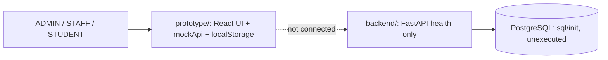

# PlaceTrack: Campus Placement Management System

PlaceTrack centralizes a college's campus recruitment process for three roles: **ADMIN**, **STAFF** (placement staff) and **STUDENT**. It covers student placement profiles, company drives, eligibility checks, applications, interview rounds, selection, offers and placement analytics.

> **Read this first: what actually exists.**
> - A complete interactive **frontend prototype** (`prototype/`, from Google AI Studio) running on **mock data in the browser**. It is not connected to any backend or database.
> - A **FastAPI skeleton** (`backend/`) with health endpoints only.
> - An **unexecuted PostgreSQL design** (`sql/init/`): 17 tables, views, functions, procedures, triggers, seed data.
> - A Docker Compose stack for the backend/database side. The prototype is **not** part of it.
>
> Nothing has been built, run or tested in the latest review (see [docs/TESTING.md](docs/TESTING.md)). Integration between the prototype and the backend has **not started** ([docs/INTEGRATION_PLAN.md](docs/INTEGRATION_PLAN.md)).

## Problem statement

Placement data is usually scattered across spreadsheets and messages, so it is hard to see who is eligible for a drive, where applications stand, which offers exist and what the placement numbers are. PlaceTrack aims at one source of truth with role-appropriate access.

## Features (and their honest status)

| Area | Status |
|---|---|
| Landing page, sign in / sign up, 3D visuals | Prototype (simulated) |
| Role dashboards for ADMIN, STAFF, STUDENT (20 dashboard routes) | Prototype (simulated) |
| Demo identity switching, role-guarded routes | Prototype (client-side only) |
| Eligibility checks with match percentage | Prototype (client formula) and SQL functions (unexecuted) |
| Applications, interviews, selection, offers, tier policy | Prototype (simulated) and SQL triggers/procedures (unexecuted) |
| Notifications and simulated Demo Inbox | Prototype (simulated) |
| Analytics | Prototype (partly hard-coded numbers) |
| REST API for the features above | **Not implemented** (health endpoints only) |
| Real authentication and server-side authorization | **Not implemented** |

Full matrix: [docs/IMPLEMENTATION_STATUS.md](docs/IMPLEMENTATION_STATUS.md). Verified problems: [docs/KNOWN_ISSUES.md](docs/KNOWN_ISSUES.md).

## User roles

| Role | Purpose |
|---|---|
| ADMIN | Institution oversight: all staff pages plus user management, analytics, policies |
| STAFF | Placement operations: students, companies, drives, applications, interviews, offers, placements |
| STUDENT | Own profile, eligible drives, applications, interviews, offers and progress |

Demo identities (illustrative, not real people): ADMIN Ishan Wankhede, STAFF Raghav Menon, STUDENT Rohit Verma. Details: [docs/ROLE_PERMISSIONS.md](docs/ROLE_PERMISSIONS.md).

## Technology

| Layer | Actual technology |
|---|---|
| Prototype UI | React 19, Vite 8, React Router 7, Tailwind CSS 4, GSAP, Lenis, three.js + React Three Fiber, Recharts, framer-motion, jsPDF |
| Docker frontend skeleton | React 18, Vite, axios (status page only) |
| Backend | Python 3.12, FastAPI, SQLAlchemy 2, Pydantic v2 (skeleton) |
| Database | PostgreSQL 16 with `pgcrypto` |
| Tooling | Docker Compose, Mailpit (dev mail catcher), pgAdmin (optional) |

## Architecture in one picture



Details: [docs/ARCHITECTURE.md](docs/ARCHITECTURE.md), [docs/FRONTEND_ARCHITECTURE.md](docs/FRONTEND_ARCHITECTURE.md).

## Repository structure

```
PlaceTrack/
├── README.md              this file
├── PHASES.md              roadmap with real progress
├── PROMPTS.md             AI-assisted workflow and prompt library (git-ignored)
├── docker-compose.yml     db, mailpit, backend, frontend skeleton, optional pgAdmin
├── .env.example           variable names with safe placeholders
├── docs/                  PRD, ARCHITECTURE, FRONTEND_ARCHITECTURE, API, DB_SCHEMA, ER_DIAGRAM,
│                          REQUIREMENTS, TRACEABILITY, ROLE_PERMISSIONS, WORKFLOWS, TESTING,
│                          DEPLOYMENT, INTEGRATION_PLAN, KNOWN_ISSUES, IMPLEMENTATION_STATUS,
│                          PROTOTYPE_AUDIT
├── prototype/             Google AI Studio export (UI on mock data; git-ignored)
├── frontend/              Docker skeleton: health status page
├── backend/               FastAPI skeleton + tests
├── sql/init/              schema, views, functions, procedures, triggers, seed
├── sql/demo/              demonstration scripts for pgAdmin (DML, DQL, DCL, TCL, joins, ...)
└── docker/pgadmin/        pgAdmin server registration
```

`prototype/` and `PROMPTS.md` are listed in `.gitignore`; see KI-018 in the known-issues register if you want the docs' file links to work on GitHub.

## Prerequisites

Node.js and npm (prototype); Docker Desktop with Compose v2 (backend, database). No other local installs are required.

## Run the prototype (the part you can see today)

```bash
cd prototype
npm install
npm run dev          # http://localhost:3000
```

Sign in from the landing page or `/login`, then use the header role selector (demo mode) to switch between ADMIN, STAFF and STUDENT. Data persists in the browser; Student Settings has a reset action. Commands come from `prototype/package.json`; not executed in review.

## Run the Docker stack (backend + database)

```bash
cp .env.example .env            # adjust ports/secrets; never commit .env
docker compose up -d --build
curl http://localhost:8000/api/v1/health/db
```

`sql/init/*.sql` run automatically on an empty database volume. Ports, services, pgAdmin connection and troubleshooting: [docs/DEPLOYMENT.md](docs/DEPLOYMENT.md). The first run is the first real test of the SQL scripts.

## Testing

Backend: `docker compose exec backend pytest -q` (2 health tests, never executed). Prototype: no tests. Recommended smoke tests and database checks: [docs/TESTING.md](docs/TESTING.md).

## Database

17 tables with eligibility, tier-policy, status-transition, offer and notification logic in SQL. Documentation generated from the SQL: [docs/DB_SCHEMA.md](docs/DB_SCHEMA.md), [docs/ER_DIAGRAM.md](docs/ER_DIAGRAM.md). The prototype needs entities the schema lacks (messaging, policies, staff profiles, settings) and uses different status names; the gap table is in DB_SCHEMA.md.

## Known limitations

No real authentication (anyone can become ADMIN in the prototype), no server-side authorization, no integration, nothing executed in review, several settings stored but not enforced, analytics partly hard-coded. See [docs/KNOWN_ISSUES.md](docs/KNOWN_ISSUES.md).

## Roadmap

See [PHASES.md](PHASES.md) and [docs/INTEGRATION_PLAN.md](docs/INTEGRATION_PLAN.md).

## License

Internal academic project.
