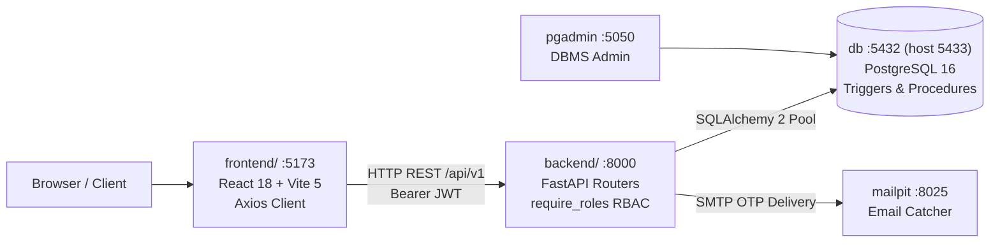

# PlaceTrack: Campus Placement Management & Analytics System

PlaceTrack centralizes a college's campus recruitment operations for three roles: **ADMIN**, **STAFF** (Placement Officer / Coordinator), and **STUDENT**. It covers student academic profiles, corporate recruitment drives, automated eligibility evaluation, job applications, interview rounds, candidate selection, offer letters with tier-progression enforcement, and placement analytics.

---

## 1. System Reality & Implementation State

- **Active Web Client (`frontend/`)**: React 18.3.1 + Vite 5.4.21 + Tailwind CSS + Axios. Mounted in Docker on `http://localhost:5173`. Connected via Bearer JWT to the FastAPI backend for authentication, student profile, drives, applications, offers, and notifications.
- **Backend API (`backend/`)**: FastAPI + SQLAlchemy 2 + Pydantic v2. Exposes 11 operational routers with bcrypt password hashing, HS256 JWT access tokens, role-based authorization guards (`require_roles`), and relational SQL joins.
- **Database (`sql/init/`)**: PostgreSQL 16 container (`placetrack-db`) running 17 tables in 3NF, 13 views (including materialized view `mv_placement_kpis`), domain CHECK constraints, triggers enforcing business invariants, and stored procedures.
- **Historical Prototype (`prototype/`)**: Google AI Studio export (React 19 / Vite 8 / client mocks), preserved as a static UI/UX design reference.
- **Verification Evidence**: **115 passing tests** in Pytest (`pytest -v`), clean Vite production build (41.26s, 0 errors), and live PostgreSQL 16 queries verified via health endpoints.

---

## 2. Feature Implementation Status

| Feature Area | Architectural Implementation | Verified Status |
|---|---|---|
| **Landing Page & 3D Workstation** | React 18, Three.js / R3F, smooth scroll | **Integrated and verified** |
| **Authentication & Tokens** | Bcrypt password hashing, HS256 JWT, OTP signup via Mailpit | **Integrated and verified** |
| **Server-Side RBAC** | FastAPI dependency injection (`require_roles`) | **Integrated and verified** |
| **Profile Role Isolation** | Admin/Staff institutional credentials; Student academic fields isolated | **Integrated and verified** |
| **Student Roster & Verification** | Student directory, CDC CGPA verification endpoint | **Integrated and verified** |
| **Company Partnerships** | Company directory, tier classification (`CORE`, `DREAM`, `SUPER_DREAM`) | **Integrated and verified** |
| **Job Recruitment Drives** | Drive management, dynamic eligibility criteria, cutoffs | **Integrated and verified** |
| **Applications & Lifecycle** | Application submission, duplicate prevention trigger, student tracking | **Integrated and verified** |
| **Interview Scheduling** | Multi-round interviews, meeting link actions, schedule viewing | **Implemented in backend** (Frontend transitional) |
| **Offers & Placements** | Offer release, acceptance, atomic placement confirmation, tier policy | **Integrated and verified** |
| **In-App Notifications** | Trigger-generated notifications, role-safe endpoint (`[]` for non-students) | **Integrated and verified** |
| **Placement Analytics** | Materialized view KPIs, department stats, company hiring distributions | **Integrated and verified** |
| **Peer Messaging** | Client-side simulation modal in frontend; real tables planned for Phase 2 | **Implemented in prototype** |

Full matrix: [docs/IMPLEMENTATION_STATUS.md](docs/IMPLEMENTATION_STATUS.md). Verified problem register: [docs/KNOWN_ISSUES.md](docs/KNOWN_ISSUES.md).

---

## 3. User Roles & Profile Credentials

| Role | Operational Scope | Profile Credentials Displayed |
|---|---|---|
| **ADMIN** | Institution-level oversight: user accounts, company partnerships, drive approvals, policy governance, and analytical auditing. | Role Title, Designation, Institutional Office/Unit. Academic fields (`cgpa`, `backlogs`, `roll_number`) are **strictly excluded**. |
| **STAFF** | Placement operations: recruitment drives, student eligibility auditing, interview scheduling, round progression, and offers. | Role Title, Staff Designation, Placement Office/Department. Academic fields are **strictly excluded**. |
| **STUDENT** | Placement candidate: academic profile, eligibility evaluation, job applications, interview schedules, and offer decisions. | Full Name, Roll Number, Department, Batch, Verified CGPA, Active Backlogs, Resume URL, Technical Skills. |

Details: [docs/ROLE_PERMISSIONS.md](docs/ROLE_PERMISSIONS.md).

---

## 4. Technology Stack

| Layer | Technology |
|---|---|
| **Frontend** | React 18.3.1, Vite 5.4.21, React Router 6.26.0, Tailwind CSS 3.4.17, Axios 1.7.0, Lucide React, Recharts |
| **Backend** | Python 3.12, FastAPI 0.115, SQLAlchemy 2.0, Pydantic v2, Passlib (bcrypt), Python-Jose (JWT) |
| **Database** | PostgreSQL 16 Alpine, `pgcrypto` extension, 17 tables, 13 views, triggers, stored procedures |
| **Containerization** | Docker Compose v2 with live code mounting and hot reload |
| **Tooling** | Mailpit (local email catcher on `:8025`), pgAdmin 4 (profile `tools` on `:5050`) |

---

## 5. Architecture



Details: [docs/ARCHITECTURE.md](docs/ARCHITECTURE.md), [docs/FRONTEND_ARCHITECTURE.md](docs/FRONTEND_ARCHITECTURE.md).

---

## 6. Repository Structure

```
PlaceTrack/
├── README.md              Project overview and architecture
├── PHASES.md              Development roadmap and phase completion
├── docker-compose.yml     Multi-container stack (frontend, backend, db, mailpit, pgadmin)
├── .env.example           Template environment configuration
├── docs/                  Authoritative system documentation (18 files)
│   ├── PRD.md             Product requirements and feature scope
│   ├── ARCHITECTURE.md    Full-stack system architecture
│   ├── FRONTEND_ARCHITECTURE.md Frontend architecture and data flow
│   ├── API.md             FastAPI REST endpoints and schemas
│   ├── DB_SCHEMA.md       PostgreSQL 16 relational data dictionary
│   ├── ER_DIAGRAM.md      Entity-relationship diagram (17 tables)
│   ├── REQUIREMENTS.md    Functional and non-functional requirements
│   ├── TRACEABILITY.md    Code-to-documentation traceability matrix
│   ├── ROLE_PERMISSIONS.md Role permissions and profile credentials
│   ├── WORKFLOWS.md       System lifecycle workflows
│   ├── SECURITY.md        Security controls and verification audit
│   ├── TESTING.md         Authoritative test and verification evidence
│   ├── DEPLOYMENT.md      Docker setup and troubleshooting
│   ├── INTEGRATION_PLAN.md Migration plan and status
│   ├── KNOWN_ISSUES.md    Defect and resolution register
│   ├── IMPLEMENTATION_STATUS.md Layer overview and status matrix
│   ├── PROTOTYPE_AUDIT.md Historical prototype file inventory
│   └── DEMO_SCRIPT.md     DBMS viva and presentation walkthrough
├── frontend/              Active containerized React 18 web application
├── backend/               Active containerized FastAPI backend & Pytest suite
├── sql/init/              PostgreSQL 16 DDL, views, functions, procedures, triggers, seed
├── sql/demo/              DBMS viva SQL demonstration scripts for pgAdmin
└── prototype/             Historical Google AI Studio prototype (UI reference)
```

---

## 7. Running the Application

### Start Multi-Container Stack

```bash
# 1. Initialize environment file
cp .env.example .env

# 2. Launch all services with hot reload
docker compose up -d

# 3. Check container health
docker compose ps
```

- **Web Application**: `http://localhost:5173`
- **FastAPI Documentation**: `http://localhost:8000/docs`
- **Mailpit Email Catcher**: `http://localhost:8025`
- **PostgreSQL Database**: `localhost:5433` (User: `placetrack`, DB: `placetrack_db`)
- **pgAdmin 4** (optional): `docker compose --profile tools up -d` -> `http://localhost:5050`

---

## 8. Verification & Testing

```bash
# Execute automated backend test suite (115 tests)
docker compose exec backend pytest -v

# Verify frontend production build
docker compose exec frontend npm run build

# Verify database connection pool health
curl http://localhost:8000/api/v1/health/db
```

Details: [docs/TESTING.md](docs/TESTING.md).
