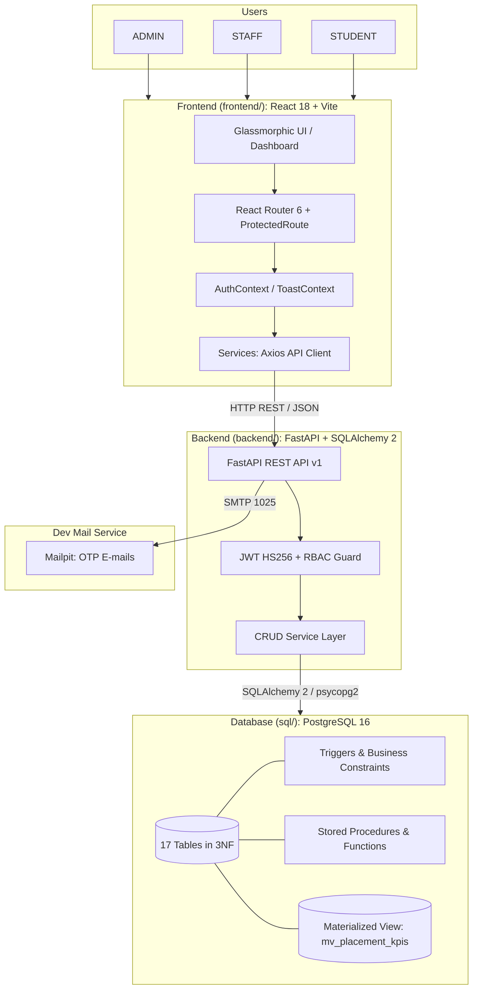

# Architecture

PlaceTrack is a production-grade Placement Management & Analytics System designed for enterprise campus recruitment and DBMS course demonstration. The system features a unified multi-tier architecture with full end-to-end integration across the frontend, REST API, and PostgreSQL database.

---

## 1. High-level System Architecture

---

## 2. Frontend Architecture

- **Active Application Stack (`frontend/`)**: React 18.3.1, Vite 5.4.21, React Router DOM 6.26.0, Tailwind CSS 4, Recharts, Framer Motion, Three.js, Lucide Icons, Axios 1.7.0.
  - Runs in Docker on port `5173`.
  - Built production bundle verified with `vite build` (0 errors).
- **Historical Reference Stack (`prototype/`)**: Standalone AI Studio prototype export (React 19, Vite 8, React Router 7) retained for UI design reference.
- **State Management**: Context-based auth (`AuthContext.jsx`), toast notifications (`ToastContext.jsx`).
- **Data Layer**: Clean service architecture in `frontend/src/services/` (`api.js`, `authService.js`, `analyticsService.js`, `studentsService.js`, `jobsService.js`, `applicationsService.js`, `offersService.js`, `notificationsService.js`).
- **Integration Boundary**:
  - Integrated via real REST API: `AuthPage` (login/signup OTP), `StudentOverview`, `AdminOverview`, `StudentMyApplications`, `StudentMyPlacement`, `NotificationsPage`, `ProfilePage`.
  - In transition (client simulation fallback): `StaffInterviewsPage`, `StaffResultsSelectionPage`, `PlacementPoliciesPage`, `UserManagementPage`, and `DemoInboxModal`.
- **Responsive Design**: Mobile, tablet, and desktop responsive with custom glassmorphism components (`GlassCard.jsx`, `StatCard.jsx`, `SmoothCursor.jsx`).

---

## 3. Backend Architecture

- **Stack**: FastAPI 0.111+, SQLAlchemy 2.0, Pydantic v2, python-jose, passlib (bcrypt).
- **Location**: `backend/`
- **Router Layout** (`app/routers/`):
  - `auth`: Login, JWT issuance, OTP registration.
  - `students`: Roster management, student profile, CGPA verification.
  - `companies`: Partner company records and campus contacts.
  - `jobs`: Recruitment drives, criteria configuration, candidate evaluation.
  - `applications`: Application lifecycle transitions.
  - `interviews`: Round scheduling and results.
  - `offers` & `placements`: CTC breakdown, acceptance/decline, confirmed placement records.
  - `analytics`: Materialized view KPI queries, department stats, NIRF reports.
- **Testing**: 115 automated tests in `backend/tests/` running with pytest, pytest-cov, and savepoint-based transaction isolation (`join_transaction_mode="create_savepoint"`).

---

## 4. Database Architecture (Source of Truth)

- **Engine**: PostgreSQL 16
- **DDL & Schema**:
  - `01_ddl.sql`: 17 normalized tables with CHECK, UNIQUE, and FOREIGN KEY constraints.
  - `02_views.sql`: Materialized view `mv_placement_kpis`, `v_department_stats`, `v_company_selections`, `v_offer_overview`.
  - `03_functions.sql`: `fn_is_eligible`, `fn_policy_allows`, `fn_match_score`, `fn_generate_otp`.
  - `04_procedures.sql`: `sp_schedule_interview`, `sp_record_interview_result`, `sp_set_offer_breakdown`, `sp_respond_to_offer`, `sp_refresh_analytics`.
  - `05_triggers.sql`: Auto-offer generation on selection, eligibility enforcement on insert, legal status transition validator, audit logging.
  - `06_seed.sql`: Rich campus recruitment seed data with 12 students, 5 partner companies, 7 jobs, and active applications.

---

## 5. Security & Isolation

- **Authentication**: JWT HS256 tokens with configurable expiry (`ACCESS_TOKEN_EXPIRE_MINUTES`).
- **Authorization**: Granular RBAC (`require_roles("ADMIN", "STAFF")`) on all administrative and reporting endpoints.
- **CORS**: Confined strictly to frontend host (`http://localhost:5173`).
- **Error Shielding**: Standard error body format `{"detail": ..., "code": ...}` without internal database details or stack trace leakage.
