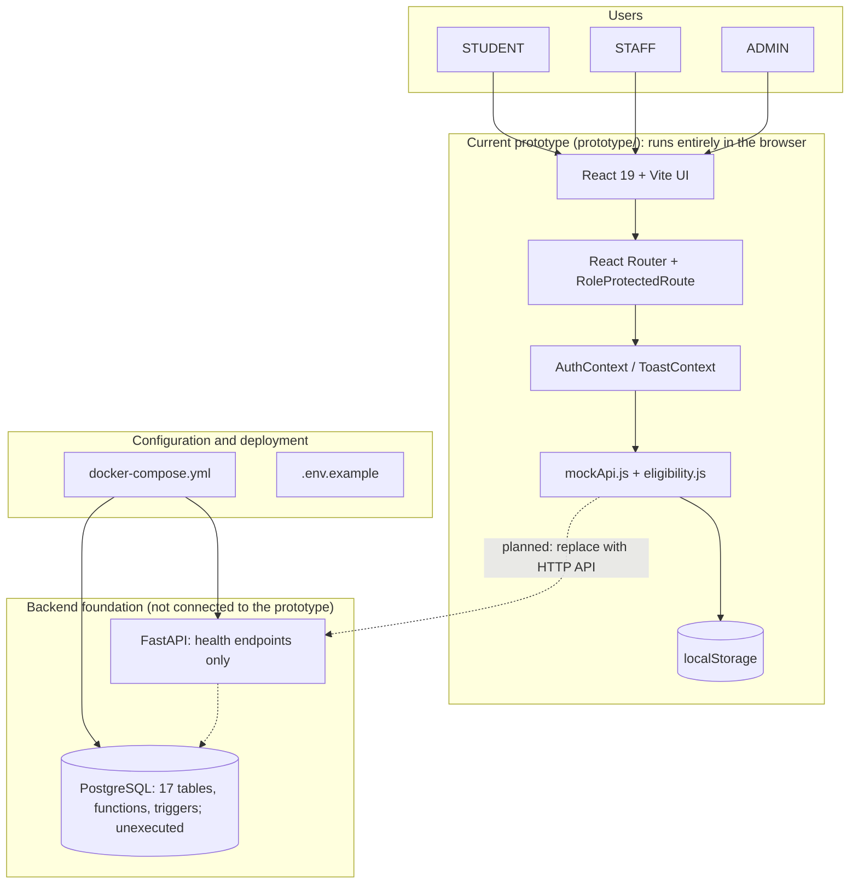
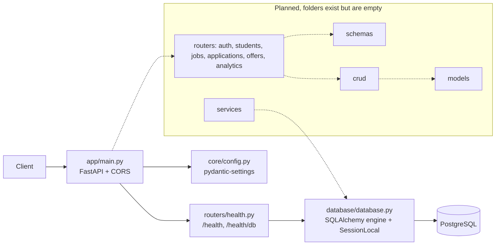

# Architecture

PlaceTrack has two layers that are **not connected today**: a complete browser-only prototype (current implementation) and a backend plus database foundation (starter code and unexecuted SQL). This document keeps them separate.

Dashed boxes in diagrams are planned or unconnected parts.

## 1. High-level system architecture

## 2. Frontend architecture

Detail: [FRONTEND_ARCHITECTURE.md](./FRONTEND_ARCHITECTURE.md). Summary: React 19, Vite 8, React Router 7, Tailwind CSS 4, GSAP + Lenis (landing), three.js with React Three Fiber, Recharts, framer-motion / motion, jsPDF. Provider order `AuthProvider > ToastProvider > BrowserRouter`. State is React context plus a module-level mock store; there is no HTTP client in the prototype.

There are two frontends in the repository:

| Folder | Purpose | Talks to backend? |
|---|---|---|
| `prototype/` | Full UI (landing, auth, 20 dashboard routes) | No |
| `frontend/` | Docker skeleton: one status page calling `/health` and `/health/db` through axios | Yes (health only) |

## 3. Backend architecture

Implemented endpoints: [API.md](./API.md). Layering rule from the earlier plan: routers -> schemas -> crud/services -> models; business rules live in the database (functions, procedures, triggers) and the API only calls them.

## 4. Database architecture

PostgreSQL 16, schema defined by `sql/init/01..06`. 17 tables, 7 views (one materialized), 23 functions (including trigger functions), 14 procedures, 9 triggers, 19 explicit indexes. Entities and constraints: [DB_SCHEMA.md](./DB_SCHEMA.md); diagram: [ER_DIAGRAM.md](./ER_DIAGRAM.md). Business rules in SQL: eligibility, tier policy, legal status transitions, offer creation on selection, audit history and notifications. **Status: written, not executed.**

## 5. Authentication and authorization

- Prototype: demo session in `localStorage`; no password check; client route guards. See [ROLE_PERMISSIONS.md](./ROLE_PERMISSIONS.md).
- Planned: JWT login against `users` (bcrypt hashes already produced by `pgcrypto` in the seed), role dependencies in FastAPI, ownership checks per request. Not implemented.

## 6. Mock-data architecture

`prototype/src/services/mockApi.js` (5,305 lines) holds seed arrays (8 students, 6 jobs, 8 applications, 6 interviews, 8 offers, 5 companies, 12 notifications, 4 conversations, 4 staff/admin accounts, policies, analytics base), 51 async methods with artificial delays, and persistence of the whole state as one JSON blob in `localStorage` key `placetrack_demo_data_v5`. `resetDemoData` restores the seed. Notifications and messages are generated by the same module (`pushNotification`, `sendMessage`).

## 7. API communication

- Prototype: direct function calls to `mockApi`; **no HTTP**.
- Docker skeleton frontend: axios to `VITE_API_BASE_URL` (`/api/v1`).
- Planned: replace each `mockApi` method with an API call keeping the same names and snake_case fields ([INTEGRATION_PLAN.md](./INTEGRATION_PLAN.md)).

## 8. Notifications and messaging

Detailed in [WORKFLOWS.md](./WORKFLOWS.md) sections 8 and 9. Both are simulated in the browser; the SQL `notifications` table only covers student recipients; messaging has no tables.

## 9. Deployment and configuration

[DEPLOYMENT.md](./DEPLOYMENT.md). Docker Compose defines `db`, `mailpit`, `backend`, `frontend` and an optional `pgadmin` profile. The prototype is not part of the Compose stack.

## 10. Error handling, logging, testing

- Prototype: mock methods throw `Error` with messages that pages show as toasts; no logging service; no tests.
- Backend: no custom error handling yet; the earlier plan maps SQL `RAISE EXCEPTION` to HTTP 422, unique violations to 409. Not implemented.
- Tests: [TESTING.md](./TESTING.md).

## 11. Current limitations and integration plan

[KNOWN_ISSUES.md](./KNOWN_ISSUES.md), [INTEGRATION_PLAN.md](./INTEGRATION_PLAN.md).
