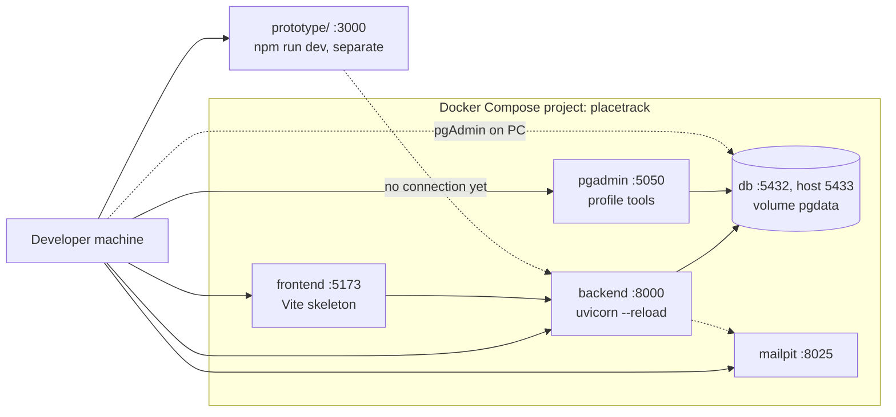

# Deployment and Local Setup

Everything here is a **local development setup**. No cloud infrastructure, production hosting or CI is configured. The Docker files were written but **not executed** in review (KI-020); the commands are taken from `docker-compose.yml`, `backend/Dockerfile`, `frontend/Dockerfile` and `prototype/package.json`.

## 1. Two ways to run

| Mode | What runs | Connected to DB? |
|---|---|---|
| A. Prototype only | `prototype/` Vite dev server on port 3000 with mock data | No |
| B. Docker stack | PostgreSQL, Mailpit, FastAPI backend, the `frontend/` skeleton (status page) and optional pgAdmin | Backend yes; the prototype is **not** part of this stack |

## 2. Mode A: run the prototype

Prerequisite: Node.js and npm (no version is pinned in `package.json`; use a current LTS).

```bash
cd prototype
npm install
npm run dev        # vite --port=3000 --host=0.0.0.0  ->  http://localhost:3000
npm run build      # production build into prototype/dist
npm run preview    # serve the build
```

No environment variables are required. `.env.example` lists `GEMINI_API_KEY` and `APP_URL` as AI Studio leftovers; no source file uses the Gemini key. Do not commit a `.env` file.

## 3. Mode B: run the Docker stack

Prerequisite: Docker Desktop (Compose v2).

```bash
cp .env.example .env            # then adjust ports and secrets; never commit .env
docker compose up -d --build    # first time or when dependencies change
docker compose ps
docker compose logs -f backend
docker compose down             # keep data
docker compose down -v          # also wipe the database volume (re-runs sql/init)
docker compose --profile tools up -d   # adds pgAdmin
```

### Services and ports (host side configurable in `.env`)

| Service | Container | Default host port | Notes |
|---|---|---|---|
| `db` | `postgres:16-alpine` | `DB_PORT` = 5433 (container 5432) | Mounts `sql/init` read-only into `/docker-entrypoint-initdb.d`; scripts run only on an empty volume. Health check: `pg_isready` |
| `mailpit` | `axllent/mailpit` | `MAILPIT_PORT` = 8025 | Dev inbox for future OTP e-mails; SMTP port 1025 stays inside the network |
| `backend` | built from `backend/Dockerfile` (Python 3.12) | `BACKEND_PORT` = 8000 | `uvicorn --reload`; code bind-mounted; waits for a healthy `db` |
| `frontend` | built from `frontend/Dockerfile` (Node 20) | `FRONTEND_PORT` = 5173 | Vite dev server with polling; `node_modules` in a named volume |
| `pgadmin` | `dpage/pgadmin4` (profile `tools`) | `PGADMIN_PORT` = 5050 | Server "PlaceTrack DB (docker)" pre-registered via `docker/pgadmin/servers.json` |

### Environment variables (names only; values in `.env`)

`POSTGRES_USER`, `POSTGRES_PASSWORD`, `POSTGRES_DB`, `DB_PORT`, `BACKEND_PORT`, `FRONTEND_PORT`, `PGADMIN_PORT`, `MAILPIT_PORT`, `JWT_SECRET`, `JWT_ALGORITHM`, `ACCESS_TOKEN_EXPIRE_MINUTES`, `CORS_ORIGINS`, `VITE_API_BASE_URL`, `PGADMIN_EMAIL`, `PGADMIN_PASSWORD`, `MAIL_FROM`. Inside Compose the backend also receives `DATABASE_URL`, `SMTP_HOST` and `SMTP_PORT`. `JWT_SECRET` is declared but nothing uses it yet.

### Health checks

```bash
curl http://localhost:8000/health
curl http://localhost:8000/api/v1/health/db      # public_tables expected: 17 after init scripts succeed
docker compose exec db psql -U placetrack -d placetrack_db -c "SELECT COUNT(*) FROM placements;"
```

### Connecting pgAdmin from your PC

Host `localhost`, port = `DB_PORT` (5433 by default), maintenance database = `POSTGRES_DB`, user and password from `.env`. Then open files from `sql/demo/` in the Query Tool.

## 4. Deployment diagram (local development)



## 5. Troubleshooting (expected failure modes, untested)

| Symptom | Likely cause | Action |
|---|---|---|
| `db` unhealthy, backend never starts | An init SQL script failed | `docker compose logs db`; fix the reported statement; `docker compose down -v && docker compose up -d` |
| `/health/db` returns 500 | Database unreachable or credentials differ from `.env` | `docker compose ps`; check `POSTGRES_*` values and re-create volume |
| `public_tables` is 0 | Volume existed before scripts were added | `docker compose down -v` |
| Port already in use | Another service on 5433/8000/5173/5050/8025 | Change the `*_PORT` variable |
| Hot reload not updating on Windows/macOS | File-event limits on bind mounts | Polling is already enabled (`WATCHFILES_FORCE_POLLING`, Vite `usePolling`) |
| Prototype `npm run lint` fails | Script runs `tsc` with no TS sources | Known (KI-014) |

## 6. Not configured

Production images, reverse proxy, TLS, CI/CD, backups, monitoring, log aggregation, secrets management.
