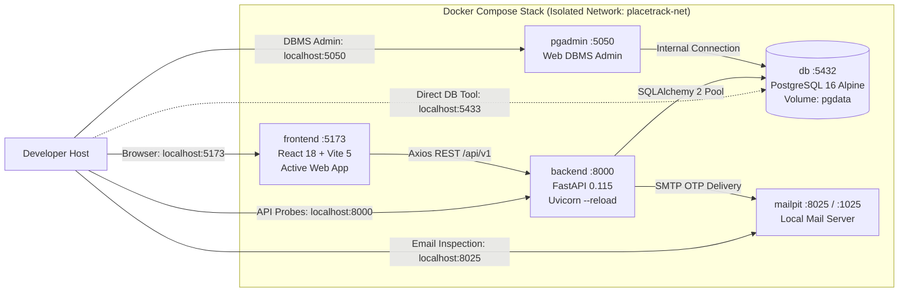

# Deployment and Local Development Setup

PlaceTrack is configured as a multi-container local development stack running under Docker Compose. All components are containerized with live code mounting, hot-reload, and isolated networking.

---

## 1. Architecture & Running Services

The Docker Compose configuration (`docker-compose.yml`) orchestrates 5 container services:

| Service | Container Name | Image / Build Source | Internal Port | Host Port | Purpose & Verified Status |
|---|---|---|---|---|---|
| **Frontend** | `placetrack-frontend` | `frontend/Dockerfile` (Node 20 Alpine) | 5173 | `5173` | **Integrated and verified.** Active React 18 + Vite 5 web application with hot module replacement (HMR). |
| **Backend** | `placetrack-backend` | `backend/Dockerfile` (Python 3.12 Slim) | 8000 | `8000` | **Integrated and verified.** FastAPI REST API running with Uvicorn live reload and SQLAlchemy 2 async connection pool. |
| **Database** | `placetrack-db` | `postgres:16-alpine` | 5432 | `5433` | **Integrated and verified.** PostgreSQL 16 initialized with 17 tables, 13 views, triggers, and seed data from `sql/init/`. |
| **Mailpit** | `placetrack-mailpit` | `axllent/mailpit:latest` | 1025 (SMTP), 8025 (UI) | `8025` | **Integrated and verified.** Local email catcher for OTP signup verification and password reset inspection. |
| **pgAdmin** | `placetrack-pgadmin` | `dpage/pgadmin4:latest` (profile: `tools`) | 80 | `5050` | **Integrated and verified.** Web DBMS administration interface pre-configured with PlaceTrack connection. |

---

## 2. Quick Start (One-Command Launch)

### Prerequisites
- Docker Desktop with Compose v2 installed and running on Windows, macOS, or Linux.

### Commands

```bash
# 1. Clone repository & initialize environment
cp .env.example .env

# 2. Start core services in background (frontend, backend, database, mailpit)
docker compose up -d

# 3. Check container status
docker compose ps

# 4. View live logs
docker compose logs -f backend
docker compose logs -f frontend

# 5. Run test suite inside backend container
docker compose exec backend pytest -v

# 6. Verify frontend production build inside container
docker compose exec frontend npm run build

# 7. Stop containers (preserves database data volume)
docker compose down

# 8. Full reset (wipes database volume and re-executes sql/init scripts)
docker compose down -v && docker compose up -d
```

To launch with pgAdmin 4:
```bash
docker compose --profile tools up -d
```

---

## 3. Environment Configuration

All configuration is managed through `.env` (overriding defaults in `backend/app/core/config.py`):

| Variable | Default Value | Description |
|---|---|---|
| `POSTGRES_USER` | `placetrack` | Database username |
| `POSTGRES_PASSWORD` | `placetrack_dev_password` | Database password |
| `POSTGRES_DB` | `placetrack_db` | Primary database name |
| `DB_PORT` | `5433` | Host port mapped to PostgreSQL container 5432 |
| `BACKEND_PORT` | `8000` | Host port for FastAPI REST API |
| `FRONTEND_PORT` | `5173` | Host port for React Vite frontend |
| `MAILPIT_PORT` | `8025` | Host port for Mailpit web inbox |
| `PGADMIN_PORT` | `5050` | Host port for pgAdmin 4 |
| `JWT_SECRET` | *(configured in .env)* | 256-bit secret key for HS256 token signing |
| `JWT_ALGORITHM` | `HS256` | Token signature algorithm |
| `ACCESS_TOKEN_EXPIRE_MINUTES` | `60` | Lifespan of issued access tokens |
| `CORS_ORIGINS` | `http://localhost:5173` | Allowed frontend origins |
| `VITE_API_BASE_URL` | `http://localhost:8000/api/v1` | Axios client target API URL |

---

## 4. Live Health Check Probes

Verify the active stack using HTTP curl or browser requests:

```bash
# Backend liveness
curl http://localhost:8000/health
# Response: {"status": "healthy", "service": "placetrack-backend"}

# API and database pool health
curl http://localhost:8000/api/v1/health/db
# Response: {"status": "healthy", "database": "connected", "public_tables": 17, "pool_status": "active"}

# Database table verification inside container
docker compose exec db psql -U placetrack -d placetrack_db -c "\dt"
# Displays 17 tables

# Placement record verification
docker compose exec db psql -U placetrack -d placetrack_db -c "SELECT COUNT(*) FROM placements;"
# Displays 5 placement records
```

---

## 5. Development Diagram



---

## 6. Troubleshooting Common Issues

| Symptom | Root Cause | Resolution |
|---|---|---|
| `db` container unhealthy | Corrupt volume or conflicting previous data | Run `docker compose down -v && docker compose up -d` to re-execute initialization scripts. |
| Port conflict on 5433, 8000, or 5173 | Host port occupied by local service | Modify `DB_PORT`, `BACKEND_PORT`, or `FRONTEND_PORT` in `.env`. |
| Hot reload slow or not updating on Windows | Bind mount file event delay | Polling is pre-configured via `WATCHFILES_FORCE_POLLING=true` in backend and `usePolling: true` in `vite.config.js`. |
| Mailpit inbox shows no OTPs | Student signup request failed validation | Ensure the student roll number exists in the seeded `students` roster before requesting OTP. |
