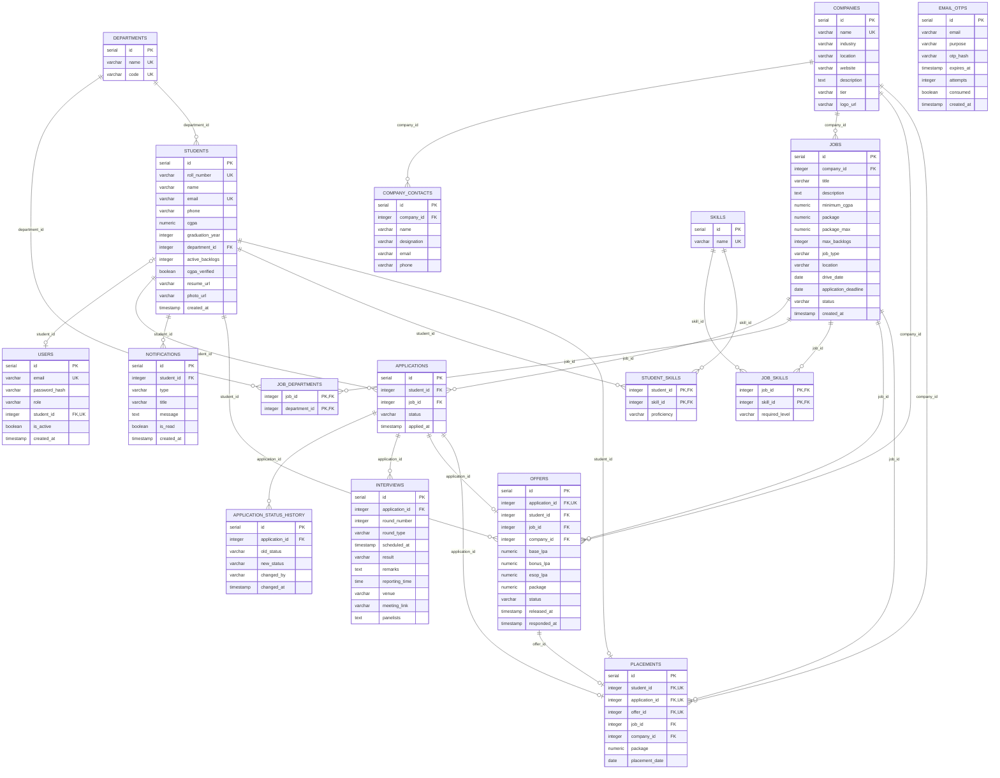

# Entity-Relationship Diagram

Generated from the verified executable schema `sql/init/01_ddl.sql` (17 tables, 24 foreign keys) active in the `placetrack-db` PostgreSQL 16 container. It reflects the live database structure; entities that appear only in frontend prototypes (such as conversations, chat messages, or dynamic policy configurations) are intentionally excluded and documented as planned. See [DB_SCHEMA.md](./DB_SCHEMA.md#5-schema-mappings--integration-gaps).

## Reading the diagram

- `||--o{` means exactly one parent to zero or many children; `|o` means the parent reference is optional (nullable FK); `o|` on the child side means at most one child (the FK column is UNIQUE).
- Junction tables `student_skills`, `job_skills` and `job_departments` use composite primary keys.
- `placements` is one row per student (`student_id` UNIQUE) and is created or upgraded only when an offer is accepted (`sp_respond_to_offer`).

## Relationships the diagram cannot express

- **Tier policy:** a student with a placement may only receive offers from a company with a higher `companies.tier` (`fn_policy_allows`, `trg_applications_create_offer`).
- **Eligibility:** computed by `fn_is_eligible` from `students`, `jobs`, `job_departments`, `job_skills` and `student_skills`; there is no stored eligibility table.
- **Application status:** legal transitions are enforced by a trigger, not by foreign keys.
- **Notifications and audit rows** are written by triggers, not by application code.
