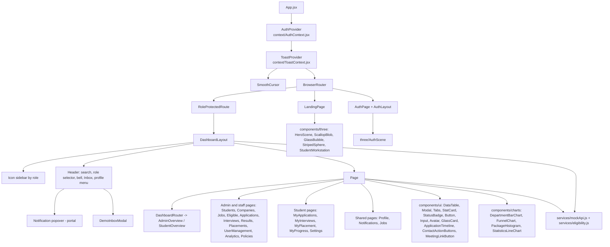

# Frontend Architecture (prototype)

Scope: `prototype/` (Google AI Studio export). Paths below are under `prototype/src/`. For a per-file list see [PROTOTYPE_AUDIT.md](./PROTOTYPE_AUDIT.md). Nothing here was executed (no build, no browser session); statements come from reading code and scripted checks.

## Stack (from `prototype/package.json`)

React 19, Vite 8 (`@vitejs/plugin-react`), React Router 7, Tailwind CSS 4 (`@tailwindcss/vite`), GSAP, Lenis, three + `@react-three/fiber` + `@react-three/drei`, Recharts, `framer-motion` and `motion`, `canvas-confetti`, `jspdf`, `lucide-react`. Declared but unused: `@google/genai`, `express`, `dotenv`, `@hugeicons/*`, `tsx` (KI-014). Dev server: `npm run dev` runs `vite --port=3000 --host=0.0.0.0`.

## Component hierarchy

## Routing

Defined in `App.jsx` (all pages imported eagerly, no `React.lazy`). Public: `/`, `/login`, `/signup`. Dashboard: 20 routes under `/dashboard`, each wrapped in `RoleProtectedRoute allowedRoles={[...]}`; unknown paths redirect to `/`. Full table with roles: [ROLE_PERMISSIONS.md](./ROLE_PERMISSIONS.md#1-route-access-verified-in-prototypesrcappjsx).

## Layouts

| Layout | File | Used by |
|---|---|---|
| `AuthLayout` | `layouts/AuthLayout.jsx` | `AuthPage` (split card with 3D scene) |
| `DashboardLayout` | `layouts/DashboardLayout.jsx` (1,135 lines) | every dashboard route, via `RoleProtectedRoute` |

`DashboardLayout` contains the role-specific sidebar arrays (ADMIN 11 items, STAFF 11 items, STUDENT 9 items), header search, the demo role selector (rendered only when `IS_DEMO_ENVIRONMENT` is true), the notification bell with a portal popover (positioned from the bell, clamped to the viewport, closes on outside click or Escape, scrolls internally), the Demo Inbox trigger and the profile menu.

## State management

| Concern | Mechanism | File |
|---|---|---|
| Active identity and role | `AuthContext`: `activeDemoUser` is the single source; `activeRole`/`accountRole` alias it; session in `localStorage` `placetrack_demo_session_v2` | `context/AuthContext.jsx` |
| Permissions | `ROLE_PERMISSIONS` (flags unused, KI-003); real checks are route guards plus ad-hoc `activeRole ===` | `AuthContext.jsx`, `App.jsx` |
| Toasts | One provider and one fixed bottom-right container; `triggerGlobalToast` helper usable outside React | `context/ToastContext.jsx` |
| Domain data | Module-level arrays inside `mockApi.js`, persisted as one JSON blob (`placetrack_demo_data_v5`) | `services/mockApi.js` |
| Page data | `useState` + `useEffect` calling `mockApi` methods; no data-fetching library | pages |

## Mock services

`mockApi.js` exports `mockApi` (51 async methods with artificial latency) plus seed constants. Groups: auth/demo accounts, students, staff accounts, companies, jobs, applications, interviews, offers/placements, policies, analytics, notifications, messaging, reset. `eligibility.js` is a pure client-side engine (CGPA, backlogs, department, skills with levels, CDC verification; match percentage clamped 18 to 99). Method catalogue: [API.md](./API.md#frontend-mock-service-methods-not-http-endpoints).

## Reusable components

`components/ui`: Button, MagneticButton, Input, Modal, Tabs, Avatar, StatCard, StatusBadge (uses `theme/tokens.js`), DataTable, GlassCard, ApplicationTimeline, ContactActionButtons (`tel:`/`mailto:`), MeetingLinkButton (validated anchor), SwipeToast, SplitText, DemoInboxModal, plus landing sections. Unused: EmptyState, Skeleton, SectionReveal, CustomCursor, PlacementHallOfFame.

## Forms and validation

Validation is hand-written inside pages (required fields, email/phone patterns, meeting-link validation in `utils/interactionHelpers.js`). The mock API throws `Error` messages that pages display as toasts. There is no schema-validation library.

## Notifications and messaging

Notification model and rules: [WORKFLOWS.md](./WORKFLOWS.md#8-notification-generation-simulated). Messaging: [WORKFLOWS.md](./WORKFLOWS.md#9-demo-messaging-simulated-frontend-only). The Demo Inbox visual requirements (black/white/grey, no "SIMULATED FRONTEND ONLY" badge, aligned Send button) are present in `DemoInboxModal.jsx` as read in source.

## Styling and responsiveness

Tailwind v4 via `@import "tailwindcss"` in `index.css`; `tailwind.config.js` and most of `theme/tokens.js` are inert (KI-016). Look: light canvas, large rounded cards, black accents, glass panels, a display font applied through a hand-written `.font-display` class in `index.css`. Responsive behaviour was not tested in a browser.
