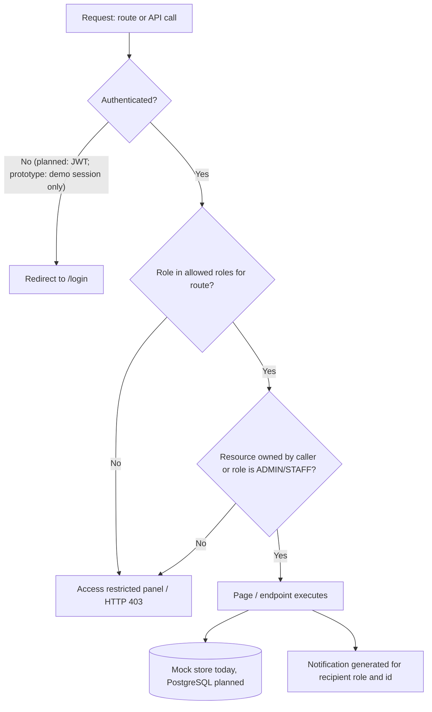

# Role Permissions

Roles: **ADMIN** (institution administration), **STAFF** (placement staff / TPO, Training and Placement Officer), **STUDENT**. STAFF is a separate role from ADMIN: the prototype gives STAFF operational pages but excludes user management, analytics and policy configuration.

> **Enforcement reality.** Everything below describes what the **React prototype** does in the browser. No server enforces any of it (KI-001, KI-002). The SQL schema stores `users.role` and enforces data rules (eligibility, status transitions, tier policy) but not per-role access; the FastAPI backend has no authentication yet. Treat this as the specification to implement server-side.

## 1. Route access (verified in `prototype/src/App.jsx`)

| Route | ADMIN | STAFF | STUDENT | Page component |
|---|:-:|:-:|:-:|---|
| `/dashboard` | yes | yes | yes | `DashboardRouter` (AdminOverview / StudentOverview) |
| `/dashboard/profile` | yes | yes | yes | `ProfilePage` |
| `/dashboard/notifications` | yes | yes | yes | `NotificationsPage` |
| `/dashboard/jobs` | yes | yes | yes | `JobsPage` (staff manage, student browse/apply) |
| `/dashboard/students` | yes | yes | no | `StudentsPage` |
| `/dashboard/companies` | yes | yes | no | `CompaniesPage` |
| `/dashboard/eligible-students` | yes (not in sidebar) | yes | no | `StaffEligibleStudentsPage` |
| `/dashboard/applications` | yes (sidebar) | yes | no | `ApplicationsPage` |
| `/dashboard/interviews` | yes (not in sidebar) | yes | no | `StaffInterviewsPage` |
| `/dashboard/results` | yes (not in sidebar) | yes | no | `StaffResultsSelectionPage` |
| `/dashboard/placements` | yes | yes | no | `PlacementsPage` |
| `/dashboard/user-management` | yes | **no** | no | `UserManagementPage` |
| `/dashboard/analytics` | yes | **no** | no | `AnalyticsPage` |
| `/dashboard/policies` | yes | **no** | no | `PlacementPoliciesPage` |
| `/dashboard/my-applications` | no | no | yes | `StudentMyApplications` |
| `/dashboard/my-interviews` | no | no | yes | `StudentInterviewsPage` |
| `/dashboard/my-placement` | no | no | yes | `StudentMyPlacement` |
| `/dashboard/my-offers` | no | no | yes (no sidebar item) | `StudentMyPlacement` |
| `/dashboard/my-progress` | no | no | yes | `StudentProgressPage` |
| `/dashboard/settings` | no | no | yes | `StudentSettingsPage` |

A denied role sees an "access restricted" panel (and, in demo mode, a button to switch to an allowed account).

## 2. Resource permission matrix (prototype behaviour)

Legend: **V** view, **C** create, **U** update, **D** delete, **A** approve/finalize, **own** own records only, **all** institution-wide (no per-staff scoping found except notification routing), **-** none. Basis: the `mockApi` methods each page calls (see [TRACEABILITY.md](./TRACEABILITY.md)). "Not enforced" means no check exists beyond the page being hidden.

| Resource | ADMIN | STAFF | STUDENT | Notes |
|---|---|---|---|---|
| User / staff accounts | V, C, U, activate/deactivate (all) | - | - | `createUserAccount`, `updateUserAccount`, `toggleUserAccountStatus`. No delete (deactivate instead) |
| Student records | V all, U skills, A CGPA verification, promote | V all, U skills, A CGPA verification, promote | V, U own profile and skills | `getStudents` returns all students to any caller (KI-002). No delete, no create from UI except signup / user management |
| Staff records | V, C, U | V own, U own profile | - | |
| Companies | V, C, U | V, C, U | - (sees company on job cards) | No delete in prototype |
| Job drives | V, C, U | V, C, U | V (eligible and ineligible, with checklist) | No delete or archive in prototype |
| Eligibility rules | U (inside job form), V | U (inside job form), V | V result checklist | Rules are fields of the job (CGPA, backlogs, departments, skills) |
| Eligible-students list | V | V, notify (`sendNotification`) | - | |
| Applications | V all, U status | V all, U status | C (apply), V own | Withdraw not implemented. `applyToJob` does not enforce rules (KI-005) |
| Interview schedule | C, U, cancel | C, U, cancel | V own | `scheduleInterview`, `updateInterview`, `cancelInterview` |
| Selection results | A (select / reject, create offer) | A | V own outcome | `updateApplicationStatus`, `createOffer` |
| Offers | C, U, V all | C, U, V all | V own, accept / decline own | `updateOfferStatus`; tier policy in `_evaluateOfferPolicyForStudent` |
| Placement analytics | V | - (overview variant only) | - | `getAnalytics` partly hard-coded (KI-009) |
| Notifications | V own, mark read, send | V own, mark read, send | V own, mark read | Filtered by recipient id and role; read state per user |
| Messages (Demo Inbox) | Message anyone: staff, students, HR contacts | Same as ADMIN | Staff and admin only | `getPermittedMessagingContacts`; frontend-only |
| Placement policies | V, U | - | V (reads policy on offers page) | Most fields not enforced (KI-006) |
| Own profile | V, U | V, U | V, U | `ProfilePage` |
| Account switching (demo) | yes | yes | yes | Demo only; must be removed or admin-only in production |

## 3. Data ownership rules to implement server-side

1. A STUDENT may read and write only rows whose `student_id` equals their own (`users.student_id`); never another student's applications, interviews, offers or notifications.
2. STAFF operate on all students, or only assigned departments if that policy is adopted. The prototype stores `assigned_departments` on staff accounts and uses it only to route notifications (`prototype/src/services/mockApi.js`).
3. ADMIN-only: user management, analytics, policy editing.
4. Eligibility, status transitions and the tier policy are enforced by SQL triggers once the database is used (`sql/init/05_triggers.sql`), independent of the role.
5. Responses must never include `password_hash` or OTP hashes.

## 4. Role and permission flow

## 5. Outstanding authorization gaps

| Gap | Severity | See |
|---|---|---|
| No authentication; any visitor can assume ADMIN | High | KI-001 |
| No server-side checks of role or ownership | High | KI-002 |
| `ROLE_PERMISSIONS` flags unused; rules scattered | Medium | KI-003 |
| Sidebar and routes disagree for ADMIN and `my-offers` | Low | KI-004 |
| STAFF department scoping only affects notifications | Medium | open question: should staff see all students? |
| Policy toggles stored but not enforced | Medium | KI-006 |
