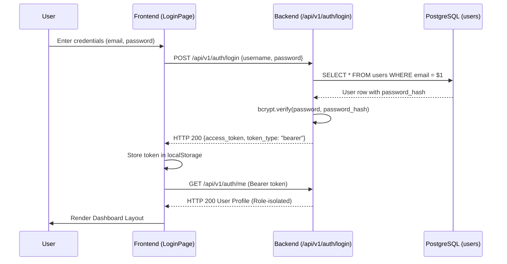
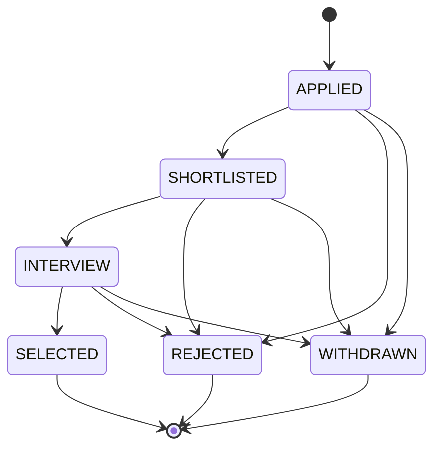

# System Workflows & Lifecycle Execution

This document details the core lifecycle workflows in PlaceTrack, specifying the initiating role, authorization guards, data transformations, database state transitions, and integration verification status.

---

## 1. Authentication & Session Workflow

| Attribute | Implementation Details |
|---|---|
| **Initiating Role** | Any unauthenticated user (`ADMIN`, `STAFF`, `STUDENT`) |
| **Status** | **Integrated and verified** |
| **Frontend Flow** | `LoginPage.jsx` submits email and plaintext password to `authService.login()`. |
| **Backend Execution** | `POST /api/v1/auth/login` checks `users.password_hash` via `passlib` bcrypt context. On success, issues an `HS256` JWT access token containing `sub` (user ID), `role`, and expiration timestamp. |
| **Client State** | Token stored in `localStorage` (`access_token`); Axios interceptor in `api.js` automatically attaches `Authorization: Bearer <token>` to all subsequent requests. |
| **Profile Resolution** | `GET /api/v1/auth/me` retrieves role-isolated credentials. Student users have their linked `students` roster record joined. |

---

## 2. Student Onboarding & OTP Signup Workflow

| Attribute | Implementation Details |
|---|---|
| **Initiating Role** | Unregistered Student present on the college academic roster |
| **Status** | **Integrated and verified** |
| **Step 1 (OTP Request)** | Student enters roll number and email on `SignupPage.jsx`. `POST /api/v1/auth/signup/request-otp` verifies student existence in `students` roster, generates a secure 6-digit OTP, stores its hash in `email_otps` with a 10-minute expiry, and dispatches the code via Mailpit. |
| **Step 2 (Verification)** | Student enters the OTP and sets their password. `POST /api/v1/auth/signup/verify` validates the unexpired OTP, hashes the new password with bcrypt, creates the `users` account with `role = 'STUDENT'`, and links `users.student_id`. |

---

## 3. Job Drive Management Workflow

| Attribute | Implementation Details |
|---|---|
| **Initiating Role** | `ADMIN` or `STAFF` |
| **Status** | **Integrated and verified** |
| **Frontend Execution** | `JobsPage.jsx` provides drive creation modal; submits company, job role, CTC package, minimum CGPA, max backlogs, eligible departments, and required skills. |
| **Backend API** | `POST /api/v1/jobs` (enforces `require_roles(["ADMIN", "STAFF"])`) validates payload using `JobCreate` Pydantic schema and persists drive to `jobs`, `job_departments`, and `job_skills`. |
| **Student Discovery** | Active drives appear on student's `StudentJobDrives.jsx` fetched via `GET /api/v1/jobs`. |

---

## 4. Student Application & Eligibility Evaluation

| Attribute | Implementation Details |
|---|---|
| **Initiating Role** | `STUDENT` |
| **Status** | **Integrated and verified** |
| **Eligibility Check** | Evaluated dynamically: drive minimum CGPA vs student CGPA, backlogs vs allowed maximum, department eligibility in `job_departments`, and placement tier upgrade rules (`fn_policy_allows`). |
| **Submission** | Student clicks Apply on `StudentJobDrives.jsx`. Client calls `applicationsService.applyToJob(jobId)`. |
| **Backend & DB Validation** | `POST /api/v1/applications` verifies student token. In PostgreSQL, `trg_applications_validate_insert` verifies drive is `OPEN`, deadline has not passed, student meets criteria, and does not already hold a higher/equal tier placement. |
| **Result** | Row inserted into `applications` with initial status `APPLIED`. Status audit row logged in `application_status_history`. |

---

## 5. Application Tracking & Status Progression

| Attribute | Implementation Details |
|---|---|
| **Initiating Role** | Student views progress; Staff/Admin advance candidates |
| **Status** | **Integrated and verified** (Core student tracking & backend progression) |
| **Student Tracking** | `StudentMyApplications.jsx` calls `GET /api/v1/applications/mine`. Returns application rows enriched via multi-table SQL joins with company name, job role, package, tier, applied date, and interview round counts. |
| **Status Pipeline** | Staff update candidate status via `PATCH /api/v1/applications/{id}/status`. Allowed transitions enforced by PostgreSQL trigger `trg_applications_validate_status`: |

---

## 6. Interview Scheduling Workflow

| Attribute | Implementation Details |
|---|---|
| **Initiating Role** | `STAFF` or `ADMIN` schedules; `STUDENT` views |
| **Status** | **Implemented in backend** (Frontend staff page transitional) |
| **Scheduling** | `POST /api/v1/applications/{id}/interviews` invokes PostgreSQL procedure `sp_schedule_interview(application_id, round_number, round_type, scheduled_at, meeting_link, venue)`. |
| **Notification** | Trigger `trg_interviews_notify` automatically generates an in-app notification row for the candidate student. |
| **Student View** | Student views scheduled rounds and meeting links on `StudentInterviewsPage.jsx` via `GET /api/v1/applications/{id}/interviews`. |

---

## 7. Offer Release, Acceptance & Placement Confirmation

| Attribute | Implementation Details |
|---|---|
| **Initiating Role** | Staff selects candidate; Student accepts/declines |
| **Status** | **Integrated and verified** |
| **Offer Release** | When application is marked `SELECTED`, trigger `trg_applications_create_offer` automatically creates a `PENDING` offer in `offers`. Staff set CTC breakdown via `PATCH /api/v1/offers/{id}/breakdown`. |
| **Student Decision** | Student views offers on `StudentMyPlacement.jsx` (`GET /api/v1/offers/mine`). Student clicks Accept or Decline (`POST /api/v1/offers/{id}/accept`). |
| **Placement Confirmation** | Database procedure `sp_respond_to_offer` executes atomically: |
| | 1. Updates offer status to `ACCEPTED`. |
| | 2. Inserts or upgrades student row in `placements` table. |
| | 3. Automatically marks any previous lower-tier accepted offer as `SUPERSEDED`. |
| | 4. Automatically marks pending offers of equal or lower tier as `LOCKED`. |
| **Offer Letter Download** | Student generates branded PDF offer summary via client-side jsPDF (`offerPdfGenerator.js`). |

---

## 8. In-App Notifications Workflow

| Attribute | Implementation Details |
|---|---|
| **Initiating Role** | System triggers dispatch; Authenticated users view |
| **Status** | **Integrated and verified** |
| **Dispatch** | Automated database triggers (`trg_applications_notify`, `trg_interviews_notify`) insert notification rows into `notifications` when application status updates or interviews are scheduled. |
| **Retrieval** | `NotificationsPage.jsx` and header bell call `GET /api/v1/notifications`. For students, returns their unread and read alerts. For Admin/Staff, returns empty list `[]` with `HTTP 200 OK` (preventing permission crashes). |
| **Mark as Read** | `PATCH /api/v1/notifications/{id}/read` updates `is_read = TRUE`. |

---

## 9. Placement Analytics & KPI Workflow

| Attribute | Implementation Details |
|---|---|
| **Initiating Role** | `ADMIN` or `STAFF` |
| **Status** | **Integrated and verified** |
| **Execution** | `AdminOverview.jsx` and `AnalyticsPage.jsx` query `analyticsService`: |
| | - `GET /api/v1/analytics/overview`: Reads pre-aggregated metrics from materialized view `mv_placement_kpis`. |
| | - `GET /api/v1/analytics/departments`: Queries `v_department_stats` for branch-wise placement percentages. |
| | - `GET /api/v1/analytics/companies`: Queries `v_company_selections` for top recruiting partners. |
| **View Refresh** | `POST /api/v1/analytics/refresh` (Admin only) executes `sp_refresh_analytics()` to refresh materialized views. |

---

## 10. Peer Messaging Workflow (Demo Simulation)

| Attribute | Implementation Details |
|---|---|
| **Initiating Role** | Authenticated User |
| **Status** | **Implemented in prototype** (Simulated frontend modal) |
| **Execution** | User opens Demo Inbox modal (`DemoInboxModal.jsx`). Client resolves contacts via permitted roles. Messages append to local state. Real database tables and WebSocket chat server are planned for Phase 2. |
