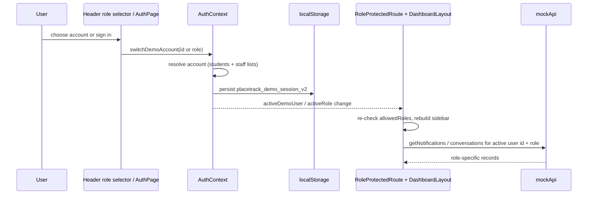
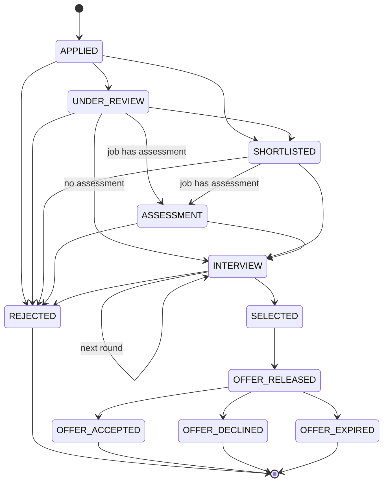
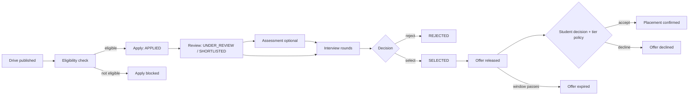

# Workflows

End-to-end flows with the initiating role, data, state transitions, permissions, resulting records and notifications. Each flow states whether it is **Simulated** (prototype + `localStorage`), **Written in SQL (not executed)**, or **Not supported**.

Source of prototype logic: `prototype/src/services/mockApi.js` unless noted. Source of database logic: `sql/init/*.sql`.

## 1. Demo login and identity switching (Simulated)

| Item | Detail |
|---|---|
| Initiator | Anyone (no credentials checked, KI-001) |
| Data | Demo accounts: ADMIN `admin-ishan` (Ishan Wankhede, Dean of Corporate Relations), STAFF `staff-raghav` (Raghav Menon), STUDENT `student-rohit` (Rohit Verma), plus other seeded students/staff and accounts created by sign up |
| Steps | `AuthPage` calls `mockApi.login`; `AuthContext.switchDemoAccount(id or role)` resolves the account from the student and staff lists and stores it as `activeDemoUser`; the session is kept in `localStorage` key `placetrack_demo_session_v2` |
| State | `activeDemoUser` is the single source; `activeRole` and `accountRole` are both aliases of it (`isPreviewMode` is always false) |
| Effects | Role guards re-evaluate; sidebar items, dashboard, profile, notifications and inbox are filtered by the active user id and role |
| Not supported | Real authentication, token expiry, logout everywhere |

## 2. Student profile setup (Simulated)

Initiator STUDENT (sign up or profile page). `registerDemoAccount` creates a student (roll number, email, department; fixed demo OTP in the UI), then `updateStudentProfile` / `updateStudentSkills` from `ProfilePage`. CGPA verification is a staff/admin toggle (`toggleStudentCgpaVerified`). SQL equivalent: `students`, `student_skills`, `users` (+ `fn_find_student_for_signup`, `fn_generate_otp`, `fn_verify_otp`), not connected.

## 3. Job drive creation (Simulated)

Initiator ADMIN or STAFF on `JobsPage`: `createJob` / `updateJob` with company, role, drive date, deadline, package range, cutoffs (CGPA, backlogs, departments, skills) and `recruitment_process`. Result: a job record; students see it on their Available Jobs page. No delete or archive. Notification to students: not verified. SQL equivalent: `jobs`, `job_skills`, `job_departments`.

## 4. Eligibility evaluation (Simulated, client-side)

`checkEligibility(student, job)` in `services/eligibility.js` evaluates CGPA, backlogs, department, required skills with levels and CDC verification, returns `{eligible, matchPercent, rules, failedRules}`. The percentage is a formula (68% skills, 32% CGPA margin, penalties, clamped 18 to 99), not a stored value. The tier policy is **not** part of it. SQL equivalent: `fn_eligibility_check` / `fn_is_eligible` / `fn_match_score` (different weights, KI-008).

## 5. Student application (Simulated)

| Item | Detail |
|---|---|
| Initiator | STUDENT on `JobsPage`; the Apply button is enabled only for eligible, open drives (UI check) |
| Call | `mockApi.applyToJob` creates an application with status `APPLIED`; a duplicate returns the existing one; **no rule re-check** (KI-005) |
| Result | Application record; notifications to responsible staff (routed by assigned department) |
| SQL equivalent | `sp_apply_to_job` + `trg_applications_validate_insert` (open job, deadline, eligibility, tier policy) |
| Not supported | Withdraw by student |

## 6. Application review, interview scheduling, selection (Simulated)

Initiator ADMIN or STAFF (`ApplicationsPage`, `StaffInterviewsPage`, `StaffResultsSelectionPage`).

Valid status transitions in the prototype (`mockApi.getValidApplicationTransitions`):

Interviews are separate records (`scheduleInterview`, `updateInterview`, `cancelInterview`) linked to an application by id. Staff set statuses; students cannot change them. Status changes push notifications to the student (`pushNotification`, with dedupe keys).

SQL equivalent (different vocabulary): APPLIED to SHORTLISTED to INTERVIEW to SELECTED, REJECTED or WITHDRAWN at any non-final step, enforced by `trg_applications_validate_status`; rounds via `sp_schedule_interview`, `sp_record_interview_result`; bulk moves via `sp_bulk_update_status`.

## 7. Offer release, acceptance and placement confirmation (Simulated)

| Step | Prototype | SQL (not executed) |
|---|---|---|
| Selected | status `SELECTED` | `SELECTED` creates a `PENDING` offer (`trg_applications_create_offer`) |
| Release | `createOffer` then status `OFFER_RELEASED` | CTC breakdown set with `sp_set_offer_breakdown` |
| Student decision | `updateOfferStatus(ACCEPTED or DECLINED)`; the tier policy (`_evaluateOfferPolicyForStudent`) may block with a reason | `sp_respond_to_offer(offer_id, accept)` |
| Placement | Offer `ACCEPTED` counts as placement | Row in `placements` created or upgraded; older accepted offer `SUPERSEDED`; same/lower-tier pending offers `LOCKED` |
| Offer letter | PDF via jsPDF (`utils/offerPdfGenerator.js`) | Not in SQL |

Tier policy (both sides): a placed student may only take an offer from a higher tier (CORE < DREAM < SUPER_DREAM; the prototype writes "Dream", "Super Dream").

## 8. Notification generation (Simulated)

`pushNotification` creates a record addressed to a recipient (`recipient_user_id` or a `target_role`), with an `event_type`, link and dedupe key. `getNotifications({userId, role})` returns items for that user or broadcast to that role; `markNotificationRead` records the user in `read_by`. Staff routing uses `assigned_departments`. The header bell shows the unread count and a portal popover; clicking an item navigates to its destination. SQL equivalent: `notifications` (students only), filled by `trg_applications_notify`, `trg_interviews_notify` and offer logic.

## 9. Demo messaging (Simulated, frontend only)

Any role opens the Demo Inbox (`DemoInboxModal.jsx`). Contacts come from `getPermittedMessagingContacts`: a STUDENT may message active staff/admin only; STAFF and ADMIN may message students, staff and company HR contacts. `openOrCreateConversation`, `sendMessage` (validates participants, appends the message, updates the conversation preview and notifies recipients). No email or SMS is sent. No SQL equivalent.

## 10. Flows not supported anywhere

Student withdrawal, deleting any record, real e-mail, resume or scorecard upload, placement certificate (backend PDF), password verification.
